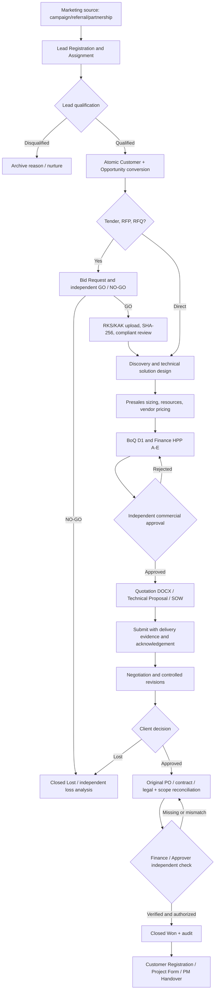

# INDIA — Integrated Commercial Lifecycle (Marketing → Closed Won)

Tanggal kerja: 21 Oktober 2026. Sumber repo: `elanghaqeem-hash/India`. Rilis yang dirancang untuk PT DefendIT360.

## 1. Operational source of truth

Use **one immutable commercial chain**:
`Lead ID → Customer Account ID → Opportunity ID → Tender/RKS Requirement IDs → BoQ ID/Version → Quotation ID → Submission Evidence → Award/PO Check → Closed Won → Post-PO`.

**Do not duplicate** client names, project title, price, SKU, service family, or manually rekey sales owner between stages. Stage gates are server-side, transactions are D1-backed and permission-controlled. Do not substitute a displayed status, mock user, AI summary or reference number for original evidence.

## 2. End-to-end workflow

## 3. Responsible handoffs and mandatory evidence

| Step | Accountable | Required inputs | System output | Gate |
|---|---|---|---|---|
| Marketing Lead | Marketing | Company, campaign/source, owner | Lead ID | Sales owner active |
| Qualification | Sales/BD | Need, budget, decision maker, procurement | Qualified Lead | All BANT fields |
| Convert | Assigned Sales | Qualified Lead, estimated value, close date, project name | Customer ID and Opportunity ID | D1 transaction, unique immutable mapping |
| Bid Decision | Approver/Admin | Bid request by different maker, reasoning | GO/NO-GO audit | No self-approval |
| RKS/KAK | Presales | Source file reference, SHA-256, parsed requirements, compliance decision | Reviewed requirement matrix | Independent technical review; original file must be archived securely |
| Scoping | Presales | Asset inventory, scope, methodologies, deliverables, SLA | Technical brief | Presales review; cross-service catalogs incomplete |
| BoQ | Sales/Finance | Same Opportunity, customer, project and service family | Versioned BoQ + HPP | No unrelated deal or unauthorized HPP edit |
| Pricing Approval | Finance/Approver | A–E HPP, margin, discount exception | Approved BoQ | Maker checker |
| Quotation | Sales | Approved D1 BoQ, recipient, signatory, validity | Draft Word, not signed | Technical/commercial review |
| Submission | Sales | Proof of actual transmission and receipt | Submission event | **Not implemented on authenticated D1 as verified evidence yet** |
| Negotiation | Sales/Management | Change log, versions and revised approvals | Final offer | **Versioned acceptance incomplete** |
| PO/Contract | Finance/Legal | Original PO/SPK, vendor signatures, tax/payment terms, approved SoW | Reconciliation check | **Original secure file archive, Legal authorization not yet integrated** |
| Closed Won | Sales / Management | Accepted offer + independent PO check | Locked Won audit | Current code uses finance attestation; strengthen proof gate before production |
| Post-PO | Project Manager | Confirmed customer registration, project form | Official-layout Word | Original templates and human signoffs required |

## 4. Actual completed technical phases

### Phase A — Merge and D1-backed Sales foundation
- Merged new `main` branch into Sales feature (the RKS/KAK extractor and its tests preserved).
- Reused existing 0003 + 0004 D1 structure, Sales role ownership, SoD, BoQ/Quotation and Post-PO mapping.
- Enhanced record ownership in BoQ, guarded against reassociation with another Opportunity.

### Phase B — Marketing-to-Sales integration
- Migration `0005_marketing_lead_flow.sql`: Marketing role, Lead, activities, immutable D1 conversion mapping.
- API `/api/marketing/leads`: lead capture, customer assignment, qualification, activity and atomic conversion.
- Menu `/sales/leads`: responsive forms and traceability to Sales detail.
- Opportunity 360 shows Lead Number/source/campaign, and its Journey 360 completion and evidence blockers.

### Phase C — Bid and requirement traceability
- Migration `0006_bid_and_requirements.sql`: independent Bid GO/NO-GO, RKS/KAK requirement summary, source reference/digest and reviewer.
- API `/api/sales/procurement`, UI `/sales/procurement?opportunity_id=...`.
- Prevent advancement to quotation on Tender/RFP/RFQ without GO + independently reviewed RKS/KAK, even if form text is changed after a negative decision.
- Existing `/api/scoping/upload` used for file text extraction; the register stores metadata, **not original file bytes**.

## 5. Next release phases

**Phase D (not yet operational):** genuine Technical Proposal and SOW builder using reviewed Scoping, vendor quotes and final approved BoQ as immutable snapshot; no fabricated specifications or unit rates.

**Phase E (partially implemented on branch):** migration `0007_quotation_submission.sql`, authenticated `/sales/submission` desk and independent Finance/Approver review; advancing to Negotiation/PO/Won is blocked without approved version-matching proof. **Still missing:** automatic customer acknowledgement, archival bytes and controlled negotiated revision snapshots.

**Phase F (partially implemented on branch):** migration `0008_po_legal_evidence.sql`, `/sales/award` reference & SHA record with distinct Finance and Legal signatures. Closed Won API now blocks unless approved quotation submission, PO check, and PO/SPK dual approval match. **Still missing:** secure R2/DMS archive integration, objective evidence authenticity and legal digital signing/contract management.

**Phase G (not yet operational):** authenticated UAT with real testers across Marketing/Sales/Presales/Finance/Approver/Admin/Viewer; mobile browser tests; AI provider tests; rollback, backup and deployment.

### Phase E1 — Quotation submission history (coded on branch)
- After quotation sent, Sales registers the exact approved BoQ ID/version, recipient and delivery proof reference/SHA.
- Finance/Approver independent of the submitting Sales verifies or rejects it; on revision, stale version cannot advance.
- D1-backed statuses are Reported / Verified / Rejected. This is **not** an email-sending integration or customer acknowledgement.

### Phase F1 — Original PO/SPK dual-review gate (coded on branch)
- Sales records PO/SPK reference and client PO number, SHA256 and archive locator; original file is not stored.
- Finance and Legal log separate reviews, independent from the document creator and from each other.
- Only when award evidence matches PO number, approved submission matches BoQ, and PO values match can Closed Won proceed.
- No production role provisioning, R2 archive, cryptographic signature verification or production UAT has been completed.

## 6. Data migration and deployment gates

- Schema migration ORDER: `0001`, `0002`, `0003`, `0004`, `0005`, `0006`, `0007`, `0008`. Some previous stage migrations were already applied, so verify `india_schema_migrations` first.
- **0005 rebuilds india_members** to include `marketing` and `legal` roles. Take and verify a backup; run only once in an approved change window.
- Run migration against isolated UAT first, inspect `PRAGMA foreign_key_check`, table/index existence, original account count, and migration versions.
- CI tests `test:marketing` and `test:sales` validate schema + regression in an in-memory SQLite environment (this is not equivalent to a real Cloudflare D1 migration).
- Worker `india` currently still uses existing D1 with no migrations 0004–0008 and **must not be deployed** until prepared.
- The Cloudflare connection returned internal errors during the current session; remote migration and live production tests remain NOT VERIFIED.
- Real `.invalid` UAT fixture emails cannot be used for genuine Cloudflare Access login.
- PR #12 remains Draft and unmerged; the merged HEAD in this branch merely resolves source conflicts, not a production deployment.

## 7. Non-negotiable acceptance checks

1. Marketing-owned leads cannot self-assign to another Sales through API, and cannot convert without qualified fields.
2. Sales B cannot read/mutate Sales A opportunities; Marketing cannot read HPP; Admin cannot self-approve own BoQ/Bid.
3. Customer/Opportunity IDs are generated once, transactions atomically convert a lead with immutable link.
4. BoQ cannot change client, project, service, or opportunity references after creation; price/SKU match approved source.
5. RKS/KAK is marked reviewed only with different reviewer, reference to original and SHA digest; malformed/absent requirement blocks quotation for tender.
6. Delivery, proposal, cost, terms and signatures in Word come from audited source, not test values.
7. Quote submission and negotiation cannot claim agreement without independent evidence.
8. Original PO/contract, legal approval, and reconciled PO ↔ BoQ must be proved prior to production Closed Won.
9. All regression + TypeScript + production build + Cloudflare packaging + real D1/Access UAT PASS.
10. After live deployment, run smoke tests and rollback drills before inviting customer users.
